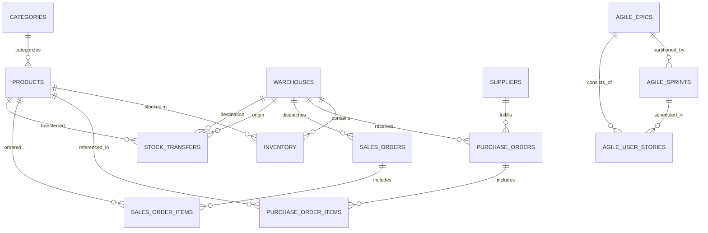

# Retail Inventory Management System (Agile Capstone Case Study)

> **Project Code**: `P_022`  
> **Track**: Full Stack Development  
> **Domain**: Retail & Supply Chain Distribution  
> **Methodology**: Scrum / Agile (8 Epics, 15 Sprints)  
> **Tech Stack**: React 18 (Vite + Tailwind CSS), Node.js (Express), SQLite / PostgreSQL, Docker, Kubernetes, Jenkins CI/CD.

---

## 📌 Executive Summary

The **Retail Inventory Management System** is an enterprise-grade full-stack web application designed for modern retail distribution networks. Delivered through a rigorous 15-sprint Agile Scrum lifecycle across 8 core epics, the platform unifies:

1. **Centralized Product Catalog & SKU Master Data**: Multi-category classification, barcode identification (EAN-13), pricing margin calculators, and automated safety stock reorder thresholds.
2. **Multi-Warehouse Distribution Network**: Real-time stock tracking across regional fulfillment hubs (Chicago, New Jersey, California, Texas), capacity utilization metrics, and physical aisle/bin location mapping.
3. **Inter-Warehouse Stock Transfers & Physical Auditing**: Atomic transfer order lifecycle (`PENDING` ➔ `IN_TRANSIT` ➔ `RECEIVED`) with inventory locking, accompanied by cycle count variance and damage adjustment auditing.
4. **Supplier Management & Procurement**: Vendor scorecards, lead-time tracking, purchase order generation, and automated Goods Receipt Note (GRN) restocking.
5. **Omnichannel Order Fulfillment**: Complete Pick-Pack-Ship stepper pipeline with automated inventory reservation, carrier tracking assignment, and invoice generation.
6. **Agile Capstone Suite**: Embedded interactive Jira-style Scrum Kanban board, velocity tracking, 8 Epics breakdown, and 15 Sprints roadmap.

---

## 🏗️ System Architecture

```
┌─────────────────────────────────────────────────────────────────────────┐
│                       PRESENTATION TIER (PORT 3000)                     │
│    React 18 SPA • Vite Bundler • Tailwind CSS • Lucide • Recharts       │
│    Interactive Scrum Kanban • Multi-Warehouse Matrix • Role Switcher    │
└────────────────────────────────────┬────────────────────────────────────┘
                                     │  HTTP REST / JSON (JWT / RBAC)
┌────────────────────────────────────▼────────────────────────────────────┐
│                      APPLICATION API TIER (PORT 5000)                   │
│    Node.js 24 • Express REST Engine • Role-Based Access Control (RBAC)  │
│    Atomic Transfer & Reservation Controllers • Immutable Audit Logger   │
└────────────────────────────────────┬────────────────────────────────────┘
                                     │  Native WAL Connection
┌────────────────────────────────────▼────────────────────────────────────┐
│                       PERSISTENCE TIER (STORAGE)                        │
│    Built-in Zero-Config SQLite (node:sqlite) • PostgreSQL Compatible    │
│    16 Relational Tables • Foreign Key Cascades • Pre-Seeded Dataset     │
└─────────────────────────────────────────────────────────────────────────┘
```

---

## 🏃 Quick Start Guide

### Prerequisites
- **Node.js**: v20+ or v24+ (Node.js v24.11 installed)
- **NPM**: v10+

### Option 1: 1-Click Launch (Windows)
Double-click `start-dev.bat` in the project root, or execute:
```powershell
.\start-dev.ps1
```

### Option 2: Manual Terminal Execution

#### 1. Start the Backend API Server
```bash
cd backend
npm install
npm run seed     # (Initializes and populates database if empty)
npm start        # Running on http://localhost:5000
```

#### 2. Start the Frontend Dev Server
```bash
cd frontend
npm install
npm run dev      # Running on http://localhost:3000
```

Visit **`http://localhost:3000`** in your browser.

---

## 🐳 Docker & Cloud Deployment

### 1. Docker Compose (Full Stack + PostgreSQL)
```bash
cd devops
docker compose up --build
```
- Frontend UI: `http://localhost:3000`
- Backend API: `http://localhost:5000`
- PostgreSQL: `localhost:5432` (Database: `retail_inventory`)

### 2. Kubernetes Cluster Deployment
```bash
kubectl apply -f devops/k8s/01-configmap.yaml
kubectl apply -f devops/k8s/02-postgres.yaml
kubectl apply -f devops/k8s/03-backend.yaml
kubectl apply -f devops/k8s/04-frontend.yaml
kubectl apply -f devops/k8s/05-ingress.yaml
```

### 3. Jenkins CI/CD Pipeline
The included `devops/Jenkinsfile` defines a 7-stage automated pipeline:
1. **SCM Checkout**: Clones branch.
2. **Backend Tests**: Syntax validation & database schema checks.
3. **Frontend Build**: Vite production build.
4. **Docker Packaging**: Builds multi-stage images for backend and frontend.
5. **Security Scan**: Trivy container vulnerability scanner.
6. **Registry Publish**: Pushes tagged images to container registry.
7. **Kubernetes Rollout**: Automated rolling update to staging/production.

---

## 📊 Agile Capstone Case Study: 8 Epics & 15 Sprints

### Agile Scrum Roles
- **Product Owner (PO)**: Backlog grooming, prioritization of business value, acceptance criteria sign-off.
- **Scrum Master (SM)**: Sprint ceremonies, velocity optimization, impediment removal.
- **Development Team**: Frontend Engineers, Backend Engineers, QA Specialists, DevOps Engineers.

### 8 Core Epics
| Epic ID | Epic Title | Priority | Sprints | Business Value |
| :--- | :--- | :---: | :---: | :--- |
| **EPIC-1** | User Authentication & RBAC | Critical | S1 - S2 | Restricts administrative operations, protects cost data, and enforces compliance. |
| **EPIC-2** | Central Product Catalog & SKU Master | High | S2 - S4 | Single source of merchandise truth with barcodes and pricing margins. |
| **EPIC-3** | Multi-Warehouse Stock & Bin Mapping | Critical | S4 - S6 | Real-time multi-location visibility with aisle/bin physical retrieval mapping. |
| **EPIC-4** | Inter-Warehouse Transfers & Audits | High | S7 - S8 | Eliminates logistics lag via regional rebalancing with physical count audit trails. |
| **EPIC-5** | Supplier Management & Procurement POs | High | S9 - S10 | Vendor scorecards, lead-time metrics, and automated goods receipt note (GRN). |
| **EPIC-6** | Sales Orders & Pick-Pack-Ship Stepper | Critical | S11 - S12 | Prevents overselling via soft-reservations and provides shipping carrier slips. |
| **EPIC-7** | Executive Analytics & Valuation Dashboard | High | S13 - S14 | Interactive Recharts visualizations of inventory turnover and dead stock alerts. |
| **EPIC-8** | Docker, Jenkins CI/CD & Kubernetes | High | S14 - S15 | Zero-downtime rolling upgrades, containerization, and cloud manifests. |

### 15 Sprints Delivery Schedule
1. **Sprint 1**: Architecture Inception & RBAC Foundation (34 pts)
2. **Sprint 2**: User Profiles & Product Catalog Schema (38 pts)
3. **Sprint 3**: Product Search, Filtering & Barcoding (40 pts)
4. **Sprint 4**: Multi-Warehouse Location Registry (36 pts)
5. **Sprint 5**: Inventory Balances & Bin Allocation (42 pts)
6. **Sprint 6**: Low Stock Triggers & Reorder Points (35 pts)
7. **Sprint 7**: Inter-Warehouse Stock Transfer Workflow (44 pts)
8. **Sprint 8**: Receiving Transfers & Cycle Count Audit (39 pts)
9. **Sprint 9**: Supplier Directory & Vendor Scorecards (37 pts)
10. **Sprint 10**: Purchase Order Creation & Goods Receipt (45 pts)
11. **Sprint 11**: Sales Order Ingestion & Stock Reservation (41 pts)
12. **Sprint 12**: Pick-Pack-Ship Stepper & Packing Slips (43 pts)
13. **Sprint 13**: Executive Analytics Dashboard & Recharts (40 pts)
14. **Sprint 14**: Docker Containerization & Compose Setup (38 pts)
15. **Sprint 15**: Jenkins CI/CD Pipeline & Kubernetes Production Manifests (42 pts)

---

## 🔌 Complete REST API Specification

| Method | Endpoint | Description | Permitted Roles |
| :--- | :--- | :--- | :--- |
| `POST` | `/api/auth/login` | Authenticate user & generate JWT | Public |
| `GET` | `/api/auth/me` | Fetch active profile | All Roles |
| `GET` | `/api/products` | Query products with category & stock filters | All Roles |
| `POST` | `/api/products` | Create SKU master with warehouse allocation | Admin, Warehouse Manager |
| `PUT` | `/api/products/:id` | Update product attributes | Admin, Warehouse Manager |
| `DELETE` | `/api/products/:id` | Soft/hard delete product from catalog | Admin |
| `GET` | `/api/warehouses` | List warehouses with capacity utilization | All Roles |
| `POST` | `/api/warehouses` | Register new regional distribution center | Admin |
| `GET` | `/api/inventory/matrix` | Cross-warehouse stock matrix lookup | All Roles |
| `POST` | `/api/inventory/adjust` | Record cycle count or damage variance | Admin, Warehouse Manager, Clerk |
| `PUT` | `/api/inventory/bin-location` | Update aisle/bin physical coordinates | Admin, Warehouse Manager, Clerk |
| `GET` | `/api/transfers` | List inter-warehouse stock transfer orders | All Roles |
| `POST` | `/api/transfers` | Initiate stock transfer between warehouses | Admin, Warehouse Manager, Clerk |
| `PUT` | `/api/transfers/:id/dispatch` | Mark transfer in-transit & deduct source | Admin, Warehouse Manager, Clerk |
| `PUT` | `/api/transfers/:id/receive` | Confirm receipt & increment destination | Admin, Warehouse Manager, Clerk |
| `GET` | `/api/suppliers` | List suppliers with scorecard ratings | All Roles |
| `POST` | `/api/suppliers` | Register new vendor partner | Admin, Procurement Manager |
| `GET` | `/api/purchase-orders` | List purchase orders | All Roles |
| `POST` | `/api/purchase-orders` | Create multi-item purchase order | Admin, Procurement Manager |
| `PUT` | `/api/purchase-orders/:id/receive` | Post Goods Receipt Note & restock items | Admin, Warehouse Manager, Clerk |
| `GET` | `/api/sales-orders` | List customer sales orders by status | All Roles |
| `POST` | `/api/sales-orders` | Create sales order & reserve stock | Admin, Sales Rep |
| `PUT` | `/api/sales-orders/:id/status` | Advance Pick-Pack-Ship fulfillment stage | Admin, Warehouse Manager, Clerk |
| `GET` | `/api/analytics/overview` | Executive KPIs, valuation, and charts | All Roles |
| `GET` | `/api/agile/overview` | 8 Epics & 15 Sprints overview | All Roles |
| `PUT` | `/api/agile/stories/:id/status` | Move user stories across Kanban columns | All Roles |

---

## 🗄️ Relational Database Schema



---

## 🎓 Capstone Presentation & Defense Highlights

- **Live Role Switcher**: Use the evaluator role switcher in the top navigation bar to test the application as **System Admin**, **Warehouse Manager**, **Inventory Specialist**, **Procurement Lead**, or **Sales Rep**.
- **Atomic Workflows**: Test initiating an inter-warehouse transfer, dispatching it, and receiving it—noticing that stock levels update immediately on the live cross-warehouse matrix.
- **Procurement Automation**: Create a purchase order, click **Receive Goods**, and see the warehouse inventory balance increment automatically with an immutable audit log entry.
- **Fulfillment Pipeline**: Follow a sales order from `PENDING` ➔ `PICKING` ➔ `PACKED` ➔ `SHIPPED`, verifying that physical inventory is deducted and a carrier tracking code is generated.
- **Agile Scrum Board**: Navigate to the **Scrum Board & 15 Sprints** tab to interactively move user stories across columns, filter by sprint, and inspect the burndown velocity chart.
